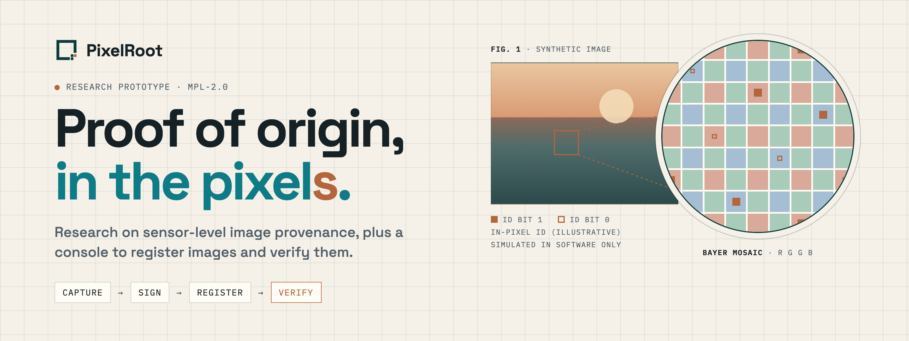
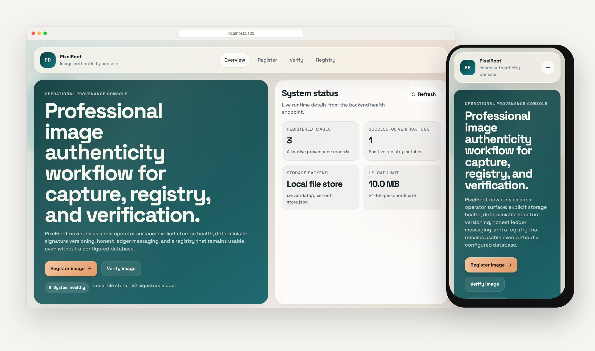
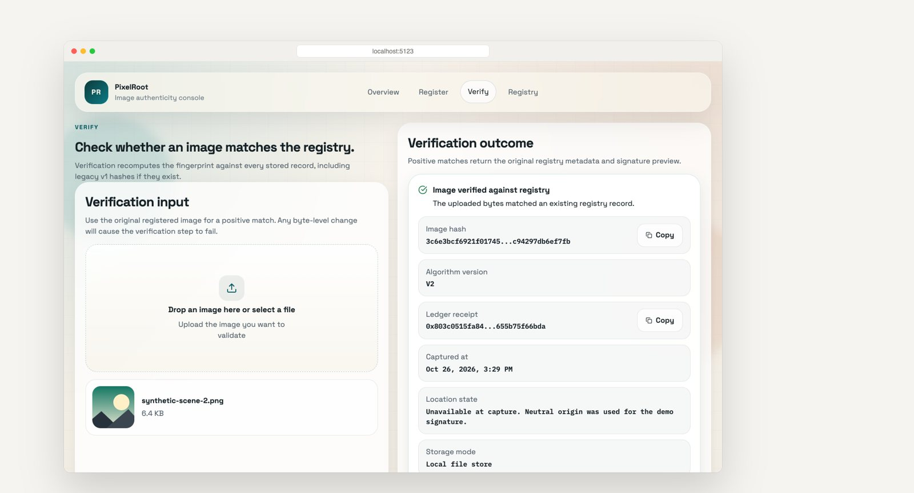
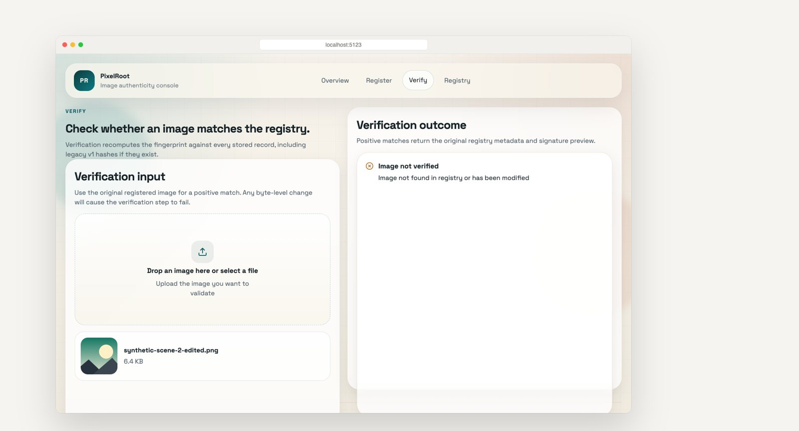
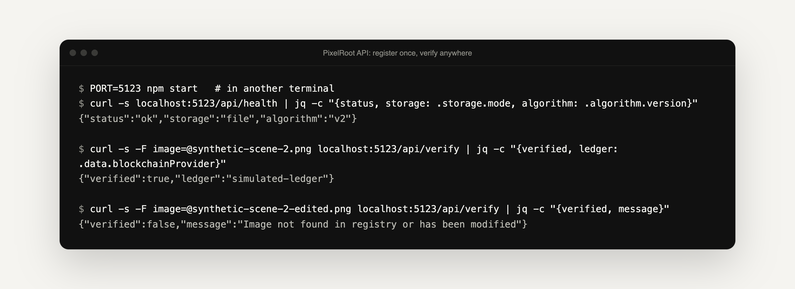
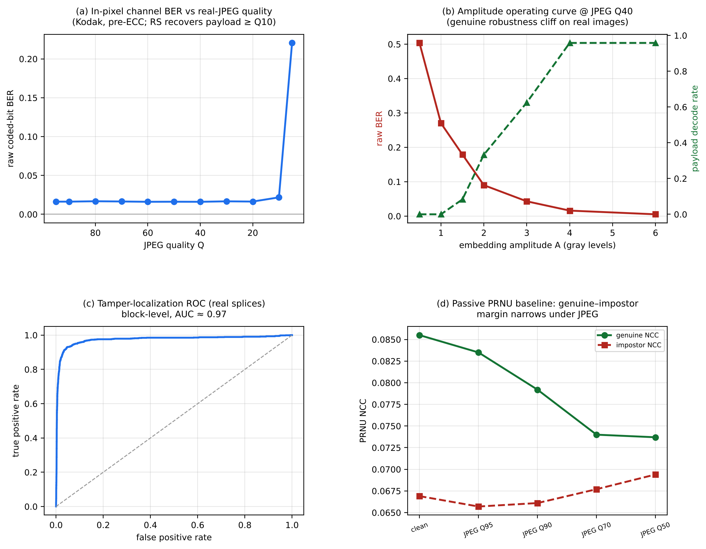

<p align="center">
  <a href="https://mihirkavi.github.io/PixelRoot/">
    <picture>
      <source media="(prefers-color-scheme: dark)" srcset=".github/assets/banner-dark.png">
      
    </picture>
  </a>
</p>

<p align="center">
  <strong>Prove a photo is real, not just guess it is fake.</strong><br>
  PixelRoot is open research on keeping proof of origin inside the image itself, plus a working web console that registers images and verifies them against a registry.
</p>

<p align="center">
  <a href="paper/pixelroot.pdf"><strong>Read the paper</strong></a> ·
  <a href="#a-quick-tour"><strong>Tour</strong></a> ·
  <a href="#run-the-console"><strong>Run the console</strong></a> ·
  <a href="#the-research"><strong>Research</strong></a> ·
  <a href="#honest-status"><strong>Honest status</strong></a>
</p>

<p align="center">
  <a href="LICENSE"></a>
  
  
  
</p>

<p align="center">
  
</p>

## Why PixelRoot

AI can now make photos and videos that people cannot tell from real recordings. Deepfake detectors keep falling behind new generators, and today's provenance standards such as C2PA keep their proof mostly in file metadata, which disappears when a platform strips or re-encodes the file.

**PixelRoot flips the question from "is this fake?" to "can this prove it is real?"** The research proposes that the camera sensor itself writes a faint, error-corrected identifier into the pixels at capture, signs a capture record with a key that never leaves the chip, and seals that record's hash on a public blockchain. The console in this repository demonstrates the register-then-verify workflow today.

<table>
  <tr>
    <td width="33%" valign="top">
      <sub><code>01</code></sub>
      <h3>Proof in the pixels</h3>
      An identifier hidden in pixel gain is designed to survive compression and metadata stripping, so the proof travels with the image.
    </td>
    <td width="33%" valign="top">
      <sub><code>02</code></sub>
      <h3>Rooted in hardware</h3>
      In the proposed design, each sensor signs its captures with its own key, and makers certify or revoke keys on a public ledger.
    </td>
    <td width="33%" valign="top">
      <sub><code>03</code></sub>
      <h3>Verify, or fail safe</h3>
      A verifier confirms an exact original, confirms a re-compressed copy, or says "unverified". It never guesses.
    </td>
  </tr>
</table>

## A quick tour

The console has four views: **Overview**, **Register**, **Verify** and **Registry**.

<table>
  <tr>
    <td width="50%" valign="top">
      
      <h4>A match</h4>
      Upload a registered image and get its fingerprint, signature version and ledger receipt back.
    </td>
    <td width="50%" valign="top">
      
      <h4>An edited copy</h4>
      Change a single pixel and verification fails with a clear "Image not verified".
    </td>
  </tr>
</table>

<p align="center">
  
  <br><sub><strong>Overview:</strong> the four steps from capture to trust, and the latest records in the registry.</sub>
</p>

Everything the console does is also available as a small JSON API:

<p align="center">
  
</p>

<sub>Screenshots and the terminal transcript are from the console running locally from this repository, with synthetic generated test images. The live GitHub Pages site currently shows this README, not the console.</sub>

## Run the console

**You need:** Node.js 20.19 or newer (required by Vite 7) and npm.

```bash
git clone https://github.com/mihirkavi/PixelRoot.git
cd PixelRoot
npm install
npm --prefix client install
npm run dev
```

Open the app at <http://localhost:5173> (the API runs on <http://localhost:5000>). Without `DATABASE_URL`, records persist in `server/data/pixelroot-store.json` and uploads in `uploads/`.

| Command | What it does |
| --- | --- |
| `npm run dev` | API server and Vite client together |
| `npm run build` then `npm start` | Build the client and serve everything from the API server (`PORT` sets the port) |
| `npm test` | Unit tests for the signature algorithm |

<details>
<summary><strong>API endpoints and storage</strong></summary>
<br>

| Endpoint | What it does |
| --- | --- |
| `GET /api/health` | Runtime health, storage mode, upload limit and active signature algorithm |
| `POST /api/register` | Create a provenance record for an uploaded image (`image` form field) |
| `POST /api/verify` | Check an uploaded image against stored records |
| `GET /api/images` | Recent registry entries |
| `GET /api/stats` | Registry totals |
| `GET /api/image/:hash` | One record by image hash |

- **With `DATABASE_URL`:** images and verifications are stored in PostgreSQL.
- **Without it:** records persist in a local JSON file, so the console works with no setup.
- The signature algorithm defaults to `v2`, which fixed a lossy coordinate-packing bug; legacy `v1` records still verify.
- If geolocation is unavailable during registration, the console uses a neutral origin and says so in the interface.

</details>

## The research

The [`paper/`](paper) folder holds a research paper on the full design, *PixelRoot: Hardware-Anchored, Sensor-Level Media Provenance with Real-Time Blockchain Notarization for Trustworthy Imaging* ([PDF](paper/pixelroot.pdf) · [Markdown](paper/pixelroot.md)), with the code and data behind every number.

<p align="center">
  
  <br><sub>Results from the paper's software experiments on public images with real JPEG codecs.</sub>
</p>

From the paper's evaluation, run in software on the 24 Kodak images:

- The in-pixel identifier survived JPEG compression down to quality 20 on 22 to 23 of 24 images, at about 38 dB PSNR, with no false accepts in 1,224 trials.
- Copying an identifier onto a different image was rejected every time (0 of 180 cross-scene copies and large splices verified), while 90% of processed genuine copies verified.
- A tested smart contract seals a batch of captures for about 47k gas.

<details>
<summary><strong>What is in the research folders</strong></summary>
<br>

| Folder | Contents |
| --- | --- |
| [`paper/`](paper) | LaTeX source, PDF, figures and bibliography |
| [`paper/experiments/`](paper/experiments) | Python experiments E1–E6 (robustness, security, localization, PRNU, cryptography, device identity), results and the [experiment plan](paper/experiments/EXPERIMENT_PLAN.md) |
| [`paper/contracts/`](paper/contracts) | The `PixelRootRegistry` Solidity contract with Hardhat tests |
| [`reports/`](reports) | Independent reviews of the design and paper, and a deepfake-provenance landscape report |
| [`research_notes/`](research_notes) | Notes on C2PA, hardware signing, watermarking prior art, regulation and threat growth |

</details>

## Honest status

PixelRoot is a **research prototype**. Please read these limits before relying on it.

- **The console and the research are different things.** The console fingerprints the uploaded file with SHA-256 and checks for an exact byte match. It does **not** embed anything into pixels, so a re-compressed copy of a registered image will not verify in the console.
- **Ledger receipts in the console are simulated.** Nothing is written to a real blockchain, and the interface labels receipts accordingly. Device MAC addresses in console records are random demo values.
- **No sensor hardware exists.** The in-pixel identifier, on-chip signing and gain control are evaluated in software simulation on public images. The paper describes how sensor makers could build them; none has.
- **The paper is a preprint draft;** treat it as unreviewed work. Its numbers come from the experiments in `paper/experiments` and are bounded by those datasets and attacks.
- The console has no accounts or access control and is meant for local or demo use.

<!-- project-artwork:start -->
## Project artwork


<sub>Conceptual project artwork, not a product screenshot. [Asset files, design notes, and generation prompts](assets/brand/README.md).</sub>
<!-- project-artwork:end -->

## License

Released under the [Mozilla Public License 2.0](LICENSE).

<p align="center">
  <br>
  <br>
  <sub><strong>PixelRoot</strong> · Proof of origin, in the pixels.</sub>
</p>
